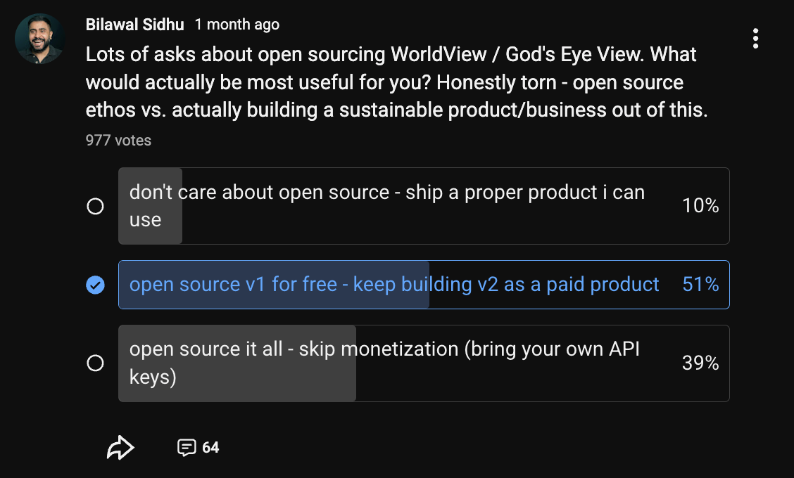

<div align="center">

# 🌐 The Watcher

### A spy-satellite simulator in your browser — then you realize the sources are public and the data is real.

**Personalized by Saad Musani**

Photorealistic 3D globe. Live aircraft, ships, satellites, earthquakes, traffic, and public cameras. Hands-free voice control powered by a realtime AI agent.

_No place left behind._

!Orbital HUD, a tracked live globe, FLIR terrain — then OPEN SOURCED

🏆
</div>

---

<div align="center">

**Quick Start · First Five Minutes · Talk to It · What's Live · Under the Hood · Keys & Costs · Contributing**

</div>

---

## 🌍 Why This Exists

The Watcher brings public signals into one explorable globe. Track the world live. Talk to it. Break it. Extend it.

Flight transponders, ship beacons, orbital elements, seismographs, and public cameras already tell us a lot about the world. The Watcher puts them in the same place, so you can move between a global picture and an individual aircraft, ship, or street. It runs locally in your browser, with source code you can inspect and extend.

> Half the magic is that it looks like a forbidden cockpit. The other half is that every line of code is inspectable.

Most feeds are live or regularly refreshed. Traffic is simulated along real
roads using aggregate location data. CCTV camera poses and rocket launch
trajectories are coarse estimates.

Start with the included data sources, then add your own. Each layer is a separate module.

---

## 🎛️ What This Thing Does

- **🛩️ Cockpit view:** Ride inside a tracked flight — the camera holds the terrain under you all the way down.
- **📡 Contacts:** A 250 km roster of everything near your target — step through live aircraft and drop into any cockpit.
- **🎯 Click-to-track anything:** Camera locks on, draws a fading trail, surfaces full metadata — and a tracked fire or vessel hands you off to the nearest live camera in one click.
- **🖊️ Voice whiteboard:** Speak annotations onto the world — real boundary polygons, marks, and routes.
- **🛫 3D hangar:** Real per-class aircraft models — 787, ATR-72, Citation, Bell 206, MQ-9 — and a tracked contact swaps from glyph to 3D model as you close in.
- **🎨 Reskin reality:** GLSL sensor looks over the normal globe — CRT, NVG, FLIR/thermal, Noir, Snow.
- **🟩 Detection overlay:** Screen-space bounding boxes and IDs on everything in view.
- **🎖️ Military HUD:** Tactical heads-up display with intelligence-style telemetry.
- **🌐 Global Context:** Stage the full situational picture with one switch — and get your exact view back when you leave.
- **🎥 Scene director:** Capture cinematic camera tours for clips and demos.
- **🔗 Share Links:** Camera, style, layers, and even one tracked target serialize into a URL — a live target is a handoff, not a bookmark.
- **🏠 Reset Globe:** One control — or one sentence — back to the full Earth.
- **🌦️ Weather:** Animate GFS or ECMWF forecast wind, replay observed radar, satellite clouds and lightning on one timeline, and follow NHC/CPHC cyclone tracks. No key needed.
- **📷 Mapped ALPR cameras:** License-plate-reader camera locations tagged in OpenStreetMap, one city at a time. Locations and tags only; no key needed.
- **🔭 Satellite passes:** Ask by voice when any loaded satellite next rises over you: rise, peak and set times, and whether you can see it.
- **🔎 Analyst answers:** Count, filter and rank satellites, datacenters and dams by voice, alongside flights, ships, fires and quakes; answers say when a feed is stale or on a fallback.
- **🧭 Tilt and North Up:** Switch between straight-down and a 35° oblique, or put north at the top, while a tracked target stays centered.
- **🔍 Keyless search:** Type coordinates or a bundled city or landmark to fly there with no network request; other names use the provider when configured, then Photon and Nominatim.
- **📦 Shareable scenes:** Import, preview and share Director scenes as files or bundles, with camera anchors, authored moves and data packs.
- **🌊 Nepal flood scene:** Replay the Bhote Koshi flood: flood path, witness sources and before-and-after imagery (bundled data is non-commercial; see DATA_SOURCES.md).

---

<div align="center">

</div>

## ⚡ Quick Start

**Start without an account or API keys.** Both paths open the same app with
the imagery provider satellite imagery and keyless terrain. OSM is the fallback if the imagery provider is
unreachable. Flights, military traffic, satellites, earthquakes, public
cameras, radio, and launches are available without keys.

For photorealistic 3D, add a **3D imagery provider token** for eligible personal,
non-commercial use, or a **mapping-provider key** for the direct, metered route and
place search. Provider terms and quotas apply. Add keys through the
app's **POWER UP** panel; Keys & Costs explains the options.

> **Already installed?** Update to the latest version. Older versions query
> public OpenStreetMap Overpass servers, which now refuse them, so Traffic,
> Mapped Installations and ALPR stay empty until you update.

### Path 1 — One click, no terminal

1. Install or update the launcher to **8.2 or later**.
2. Open The Watcher in the launcher.
3. Click **Install**, then **Start**.

Available on **Windows, macOS, and Linux**. The launcher maintainer reports
cross-platform testing of the fixed installer. The launcher installs the
locked dependencies, finds a free local port, and opens the app.

**Tried before and installation failed?** Update the launcher and try again.
Version 8.2 fixes the launcher installation issue;
details from the launcher maintainer.

### Path 2 — Terminal / coding agent

Use **Node.js 24.x (24.14.0 or later) or 26.x**. The setup doctor warns about
Node 25, which is end-of-life.

```bash

cd gods-eye-view
npm ci
npm run doctor
npm run dev
```

Open **` Choose **Live Contacts**, **Space Missions**,
**Environmental**, or **Explore Manually** from the first-run panel.

<details>
<summary>Startup performance</summary>

A point-in-time M5/Chrome capture measured a median 1.86-second cold start.
This is a comparison baseline, not a guarantee for your machine or connection.
See docs/PERFORMANCE.md.

</details>

**macOS shortcut:** `./scripts/dev-fresh.sh` clears the Vite cache and pulls any
configured keys straight from the Keychain. It starts keyless too.

### Then power it up — in the app, not in a file

Keys are upgrades, not prerequisites. When you want one, click the **POWER UP**
chip in the bottom-right corner: Provider Settings lists every supported key,
what it switches on, and where to get it. Paste, hit **SAVE KEYS**, and the app
restarts itself with the new capability on. Once everything is configured the
chip reads **POWERED UP** — and if a compact layout hides it, `?setup=1`
reopens the same panel.

- **Where keys land:** the launcher → the app's ignored `launcher/ENVIRONMENT`; a
 terminal clone → the repo-root `.env`. Either file is made owner-only
 _before_ a secret is written into it. These are local plaintext files,
 excluded from Git; the app uses your keys to contact the providers.
- **Keys you already have stay yours:** values from your shell or the macOS
 Keychain show as _configured externally_ and are read-only to the panel.
- **What to get first:** the free 3D imagery provider token
 (eligible personal, non-commercial use; current terms and quotas apply) for
 photorealistic 3D and world terrain; a mapping-provider key only for the
 billing-enabled, metered route + place search; voice provider when you want to
 talk to the world. Full map, costs included, in Keys & Costs.

<details>
<summary>Older the launcher versions and credential storage</summary>

Do not enter credentials in the launcher 8.0.40's native **Configure** panel: that
release does not save this nested app file correctly, and it logs submitted
values. Use **POWER UP → Provider Settings** inside GEV instead. The the launcher
8.2 announcement fixes installation; it does not establish that this separate
Configure issue is resolved. On macOS, the Keychain via
`./scripts/dev-fresh.sh` remains the stronger storage option.

</details>

The server binds to **localhost** on both paths, and Provider Settings answers
requests only from your machine. Browser-side keys (mapping provider, 3D imagery provider)
must be restricted at their providers — SECURITY.md shows how,
and it carries the LAN-sharing rules alongside Keys & Costs.

---

## 🕐 The First Five Minutes

Choose a first-run mission, or try these in order. The GIFs show photorealistic 3D; your starting basemap depends on the keys you've added.

1. **Light up the sky.** Take the **Live Contacts** mission (or turn on **Flights** yourself) — thousands of live aircraft, gliding on real telemetry, detection mesh already reading the scene. Click one: the camera locks on, a trail draws behind it, and its live telemetry card comes up.
2. **Take the controls.** Hit **COCKPIT** on your tracked plane and ride it down, switching sensors mid-flight: NVG into Ironbow FLIR.

!Riding with a live aircraft in cockpit view while switching sensor modes

3. **Drop into a busy airport.** Search one and descend to the taxiways with **3D** aircraft on — grounded contacts, taxi trails, the whole apron working in real time.

!Moving from a full airport overhead down to close taxiway inspection with 3D flight models

4. **Look through a public camera.** Turn on **Cameras** over Austin, London, California, Finland, or Delaware (live video). The feeds aren't webcam embeds — they project _into_ the 3D city. Cycle coverage to **VIEWSHED** and every camera draws its estimated coverage volume — where it reaches, and where it goes blind.

!Diving into an Austin intersection with a live public camera projected into the 3D scene

5. **Track something in orbit.** Turn on **Satellites** and click the ISS — you ride along at orbital distance, orbit ring and all.

!Tracking the ISS along its orbital path as it crosses over Ukraine

6. **Switch the optics.** Tap `1`–`7` — CRT, NVG, FLIR — and the whole live planet re-renders through a different sensor.

!Cycling a dense live globe through CRT, FLIR, and NVG in one continuous view

7. **Talk to it** _(needs an voice provider key)_: _"Take me to LAX and select the nearest airborne aircraft."_
8. **Come home.** Hit **Reset Globe** — or just say _"zoom out to a globe view."_

**Keyboard:** `1`–`7` visual styles · `H` HUD · `D` detection · `C` cockpit · `` ` `` frame rate · `Esc` out. Trackpad pinch zooms the globe.

---

## 🛩️ The Cockpit

> Every plane should let you do this.

Real-time cockpit mode, built from live flight data: the camera rides your contact with real terrain holding underneath, all the way down — sensor styles come along for the ride, and **Contacts** keeps the 250 km roster one click away: jump plane to plane and fall straight into the next cockpit.

!Jumping between live aircraft and falling straight into a cockpit view

The cockpit even carries its own briefing strip: nearby live signals, regional headlines, and real local weather — with an opt-in **WX** mode that renders volumetric clouds from actual observations around your aircraft.

!A live military contact ridden through Normal, NVG, and Ironbow FLIR with dense detection

_Why cockpit mode exists: you're riding a real aircraft over real terrain — and you get to pick which sensor you see the world through._

---

## 🎙️ Talk to It

> Voice needs an **voice provider key**. Without one the entire app still runs — the mic button just reports voice is unavailable. The same key drives the **AI HUD summary**: a terse, five-word intelligence-style readout of the current view that regenerates as you move.

Click **GEV MIC**, grant the microphone, and just talk. This is more than a voice-controlled remote:

- **🧠 It knows what it's looking at.** The agent pulls live scene context before answering — including coordinates, street names, active layers, and view scale. Ask _"what city is this?"_ mid-flight and it knows.
- **🎯 Entity Q&A.** Click any plane, ship, or datacenter and ask _"what's this?"_ It answers using the object's live telemetry.
- **👁️ Visual grounding.** At street level, it reads a viewport screenshot to identify legible signage and building names, and is instructed never to hallucinate labels.
- **🎬 Cinematic framing.** _"Show me the planes overhead"_ pulls the camera back, angles it, and frames the live traffic like a director.
- **🔒 Honest and secure.** The agent only confirms actions that succeeded. Your `VOICE_API_KEY` never touches the browser; the client only gets a short-lived session token.

Twenty-nine tools, four jobs — the commands below come straight from the product's voice test suite and tool playbook:

**🎥 Direct it** — drone-operator camera verbs:

> 🗣️ _"Take me to Tokyo."_ · _"Orbit around this area slowly."_ · _"Draw the walking route from the Capitol to Zilker Park."_ → _"Fly the route we just drew."_ · _"Zoom out to a globe view."_

**🖊️ Annotate it** — a whiteboard over the real world:

> 🗣️ _"Outline the state of Texas."_ · _"Annotate the Texas State Capitol and its grounds"_ — it draws the **actual enclosing boundary**, not a circle. · _"How far is the Eiffel Tower from the Louvre?"_ — a connector arrow appears and it speaks the distance. Everything persists until you say _"clear the map."_

**✍️ Or draw it yourself** — DISPLAY ▸ **Draw**: pick Area, Line or Pin, click the vertices on the real world, double-click to finish, label it. Same whiteboard, same persistence, no microphone needed.

!Zilker Park and Lady Bird Lake drawing onto the 3D city as persistent vector annotations, by voice

!A spoken distance measurement spanning an airport, inspected from orbit

**🔎 Interrogate it** — analyst queries against the live layers:

> 🗣️ _"How many flights are over Texas right now?"_ · _"Which ships are headed to Oakland?"_ · _"What is the biggest fire near Los Angeles?"_ · _"Is anything flying above forty thousand feet?"_ · _"When does the ISS pass over next?"_ · _"How many datacenters are in view?"_

**🎛️ Operate it** — the whole console, hands-free:

> 🗣️ _"Switch to night vision and turn on the flights layer."_ · _"Turn on the camera viewsheds."_ · _"Play a news radio station near Austin."_ · _"Track that plane."_ → _"Enter Cockpit."_

**And the rapid-fire tier** — one sentence each:

> 🗣️ _"Show me global infrastructure."_ (stages the layers and pulls back to the globe) · _"Play Orbital Watch."_ (a full cinematic scene) · _"Set detection density to fifty percent."_ · _"Next contact — helicopters only."_ (mid-cockpit) · _"Show me space missions."_ · _"Switch to OSM."_ · _"Sharpen the image a touch."_ · _"Switch to the tactical layout."_ · _"What's turned on right now?"_

!The globe populating with the world's radio stations as another live layer

_Ask for radio near anywhere and the globe starts broadcasting — every station is a real place you can fly to._

---

**💬 Or ask from an AI assistant and a coding assistant.** The Watcher is also an MCP server: ask an AI desktop app, a coding assistant or an AI desktop app to show a place, and the live globe opens right in the conversation. Setup takes a minute — see docs/MCP_SETUP.md.

## 🛰️ What's on the Globe

Nineteen layers and map sources. **Seventeen have a keyless path.** Some offer additional capabilities with a provider key. (🟢 no key · 🟡 free key · 🔴 metered.)

| Layer | What you get | Source | Auth |
| --------------------------- | ----------------------------------------------------------------------------------------------------------------------------------------------------------------------------------------------------------------------------------------------------------------------------------------------------------------------------------------------------------------------------------- | --------------------------------------- | --------------------------------------------------------------------------------------------------- |
| 🗺️ **Map Stack** | the imagery provider satellite imagery, photorealistic 3D, OSM, plus additional ion-hosted stacks | the imagery provider / the provider / Ion / OSM | 🟢 the imagery provider satellite + OSM · 🟡 ion-hosted photorealistic 3D + world terrain · 🔴 direct the provider + place search |
| ✈️ **Live Flights** | 11,000+ live aircraft + route history | OpenSky + adsb.lol | 🟢 (🟡 optional for more polling credits) |
| 🎖️ **Military Flights** | ADS-B military traffic in amber | adsb.lol | 🟢 |
| 🚢 **Live Vessels** | Thousands of ships worldwide | AISStream | 🟡 |
| 🛰️ **Satellites** | 838-object catalog, color-coded by class with a live legend — the **DENSE** chip drops in the whole Starlink shell | CelesTrak | 🟢 |
| 🌍 **Earthquakes** | Global seismic activity, last 24h | USGS | 🟢 |
| 🚗 **Traffic** | Simulated vehicles on OSM roads. With traffic provider, live flow speeds drive the simulation and congestion colors below ~8 km; individual vehicle positions are not live observations | traffic provider + OSM | 🟢 simulation · 🟡 live flow speeds |
| 📹 **CCTV Mesh** | ~3,600 public cameras projected _into_ the 3D space — Austin · Texas (TxDOT) · California (Caltrans) · London (TfL) · Ontario (511) · Finland (Fintraffic) · British Columbia (DriveBC) · Estonia (Tallinn, Tarktee) · Delaware (DelDOT live video) · New South Wales (Live Traffic NSW) · Calgary. Positions are published; poses are estimated priors **you calibrate by dragging a gizmo on the camera itself** | City APIs | 🟢 |
| 📷 **Mapped ALPR Cameras** | License-plate-reader camera locations tagged by OpenStreetMap contributors, loaded one city-sized view at a time, with **SHOW NEAREST**. Locations and tags only: no plate data, no video | OpenStreetMap (incl. DeFlock mapping) | 🟢 |
| 📻 **Radio** | Geolocated world radio with an **analog tuner** — drag the needle across up to 750 stations and the globe flies to each broadcaster | Radio Browser / broadcasters | 🟢 |
| 🚌 **Transit** | Live buses, trams, metros, trains and ferries with delayed playback between reports, selected-vehicle trails, and mode-coloured DETECT labels — Boston, Austin, Minneapolis, Helsinki, the Netherlands, Norway, South East Queensland | Operator GTFS-Realtime feeds | 🟢 |
| 🚲 **Bikeshare** | Live station availability | GBFS | 🟢 |
| 🧭 **Directions** | Click A and B on the globe for a street-following drive, walk or cycle route draped on the terrain with turn-by-turn steps — then FLY the camera along it. No key, no geocoder, no mic | OSRM on FOSSGIS servers (OpenStreetMap) | 🟢 |
| 🔥 **Active Fires** | Live active-fire feed detections, trailing 24h | active-fire feed | 🟡 |
| 🚀 **Space Missions** | Rolling 30-day launches with payload, stage, and recovery detail | Launch Library 2 | 🟢 (🟡 optional token raises the allowance) |
| 🎖️ **Mapped Installations** | Viewport-bounded military-site context from community mapping — incomplete by nature, and labeled that way | OpenStreetMap | 🟢 |
| 🌬️ **Wind** | Animated 10 m forecast wind with an optional speed, temperature or pressure color field and a reading at map center | NOAA GFS / ECMWF IFS | 🟢 |
| 🌦️ **Observed Weather** | Rain radar (contiguous US), Satellite clouds (GOES regional or global infrared, Clouds only or Full image) and Lightning density (Americas and Pacific) on one history timeline | NOAA nowCOAST | 🟢 |
| 🌀 **Cyclones** | Advisory positions, forecast tracks and uncertainty cones for the Atlantic and eastern/central North Pacific | NOAA NHC / CPHC | 🟢 |

**Weather, keyless.** **Wind** animates 10 m forecast flow from NOAA GFS or ECMWF IFS, with an optional color field and a reading at map center. **Rain radar**, **Satellite clouds** and **Lightning density** are observations on one history timeline in the **WEATHER** panel (step back, **Play**, **Latest**); **Cyclone advisories** draw NHC and CPHC positions, forecast tracks and cones. On photorealistic 3D tiles the observed layers float above the city as translucent shells, sharpened around your view.

In the app, **Data Layers** groups them as Movement, Cameras, Infrastructure, Events, Weather and Utilities.

**The basemap ladder — what each tier buys you:**

| You have | The globe you get |
| -------------------------- | ---------------------------------------------------------------------------------------------------------------------------------------------------------------------------- |
| 🟢 Nothing | satellite imagery satellite basemap + keyless terrain, in 2D. OSM takes over automatically if the imagery provider is unreachable; if terrain is unavailable the globe continues without it |
| 🟡 A free 3D imagery provider token | **photorealistic 3D cities** and world terrain — eligible personal, non-commercial use; current ion terms and quotas apply |
| 🔴 A mapping-provider key | The same 3D direct from the provider, plus place search — the billing-enabled, metered route |

!A reconstructed Falcon 9 ascent climbing and curving into its projected orbit

_The Space Missions layer replaying a Falcon 9 ascent — labeled `RECONSTRUCTED ESTIMATE`, scrubbable 0.25×–4×._

**Also on the globe:** neighborhood overlays · an optional cockpit WX cloud effect. **Bundled static infrastructure:** Datacenters (4,351), Dams (704), and Submarine Cables (712).

!Diving into the Bahamas and revealing labeled submarine cable routes beneath the globe

**Missing a layer you want?** Open an issue — or add it and send the PR.

---

## 🎖️ Field Missions

Once the basics click, run these:

| Mission | How |
| ----------------------------------- | --------------------------------------------------------------------------------------------------------------------------------------------------------------------------------------------------------- |
| **🚁 Ask the planet** | _"Why are all these military helicopters flying in circles?"_ Select a military track — it silently backfills ~24 h of real trace history — and see what it's been doing, resolved as stacked 3D loops. |
| **✈️ Final approach** | Click-track an airliner lining up for a runway, hop into the **cockpit**, and ride it down. |
| **🌃 Night watch** | Fly to your own city, switch to **NVG**, and let the detection mesh and HUD read the scene. |
| **🚢 Port call** | Vessels on over the Port of Long Beach. Click a tanker for its tactical card and wake trail — then hit **NEAREST** in the CCTV panel and look at the same water through a public camera. |
| **📻 Tokyo FM** | Orbit Shibuya with the **Radio** layer on — then drag the analog tuner needle: every position snaps to a real station and the globe flies to whoever's broadcasting. |
| **🔥 Fire line** | FIRMS over California. Click a detection — the camera dives to it — read the intensity, then hit **NEAREST** in the CCTV panel for a ground view. |
| **🚶 Ask for a walking route** _🎙️_ | Tell the world where you want to go and watch a real street-following route trace itself through the 3D city — then _"fly it"_: banked turns, eased ends, a camera that leads the path like a drone shot. |
| **📏 Measure LAX to DFW** _🎙️_ | _"How far is LAX from DFW?"_ — an arrow spans the country, the distance lands in the caption, and the endpoints stay pinned to the real world as you orbit. |
| **🚀 Launch replay** | Open **Space Missions**, pick a launch from the last 30 days, and ride the T-minus countdown through ascent to orbit — scrub it at 0.25×–4×. Labeled `RECONSTRUCTED ESTIMATE`, because it is one. |
| **🪦 Walk the boneyard** | Fly from regional context down into dense, fully resolved rows of retired aircraft. |
| **🏗️ Orbit Three Gorges** | Sweep the dam and its terrain at a glance — then flip on the **Dams** layer and find 703 more. |

_🎙️ = voice missions — they need an voice provider key._

!Resolving a selected aircraft's recent flight path into stacked 3D loops above the terrain

_Ask the planet: a military contact's last ~24 hours of real trace history, resolved as stacked 3D loops._

!Asking for a walking route and flying the generated path through the 3D city

_"Draw the walking route… now fly it" — banked turns, eased ends, the camera leading the path like a drone shot._

!Descending from regional context into dense rows of retired aircraft at the boneyard

_Walk the boneyard: rows of retired airframes, fully resolved in 3D._

---

## 🔧 Under the Hood

How the globe handles live data:

- **World-stable icons.** Aircraft and ships point along their _true real-world heading_ at every camera angle — tracked or not, looking straight down or across the horizon — via per-frame screen-space course projection. No spinning, no viewport-locking.
- **Smooth motion from choppy data.** Live feeds arrive every 15–30s; the globe renders one interval behind real time and interpolates between known fixes. Dead reckoning fills the gaps.
- **Honest satellites.** SGP4 propagation with orbit rings that stay locked to their satellites via GMST realignment — no drift, no per-second flicker.
- **Sits on the real ground.** Entity heights are aligned to work with photorealistic 3D tiles, so aircraft park on aprons and cameras stand on street corners instead of floating.
- **Caching and request budgets.** An OpenSky credit governor, a traffic provider daily tile budget, and disk-cached TLEs reduce repeated requests. These controls do not replace provider quotas or billing controls.
- **Server-side credentials.** Every API that touches a private key (voice provider, AISStream, OpenSky OAuth, camera frames) is brokered through a hardened server-side proxy with SSRF protection, response caps, and sanitized errors. The only keys the browser sees are mapping provider and 3D imagery provider (restrict both at the provider).
- **No framework.** Vanilla JavaScript, **3D globe engine**, and **Vite** — plus **photorealistic 3D tiles** for the planet and the **realtime voice API** for voice. Fast to read, fast to hack on.

```
src/
├── main.js # Bootstrap: photorealistic 3D tiles, layer registration
├── ui.js # Runtime UI — panels, HUD, styles, control facade
├── hud.js # Intelligence HUD + AI scene summary
├── keySetup.js # POWER UP panel — in-app provider keys (dev server only)
├── mapStackController.js # Basemap switching — photorealistic 3D / the imagery provider / OSM / ion stacks
├── voice/ # voice provider Realtime session + 29 voice tools
├── layers/ # Layer components — weather, wind, cyclones, transit, ALPR, …
├── data/ # One module per layer + orchestration + context store
│ ├── iconOrientation.js # Screen-projected headings + horizon cull
│ └── local_data/ # Bundled datasets (per-folder provenance)
└── scenes/ # Cinematic scene director
```

See `docs/CURRENT-STATE.md` for the authoritative runtime reference.

---

## 🔑 API Keys

🟢 **No key** · 🟡 **Free key** · 🔴 **Metered**

Use **POWER UP → Provider Settings** to add keys. The tables below explain what
each provider enables; none is required to start. See the
setup instructions for storage
and configuration details.

No key needed for Wind, Rain radar, Satellite clouds, Lightning density,
Cyclone advisories, Mapped ALPR Cameras, Transit, Directions, Delaware live
video, and coordinate or bundled-place search. A layer row waiting on a key
names it.

### Choose the capabilities you want

Six keys. Four have a free tier, and the two 🔴 ones are metered:

| | Key | Why | Get it |
| --- | --------------- | ------------------------------------------------------------------------------------------------------------------------------------------------------------------------------------ | -------------------------------------------------------------------------------------------------------------------------------------------------------------------- |
| 🟡 | **3D imagery provider** | 🗺️ photorealistic 3D, world terrain, and additional ion-hosted imagery stacks. The free Community plan is for eligible individual, personal/non-commercial use and has quotas | 3D imagery provider portal — use a public `assets:read` token and check current pricing/eligibility |
| 🔴 | **mapping provider** | Direct photorealistic 3D + place search (Map Tiles API) | cloud provider console — URL-restrict it |
| 🔴 | **voice provider** | 🎙️ The voice experience + AI HUD summary. The mini model works; the standard model is noticeably smarter. Want another provider behind the mic? PRs welcome | voice-provider dashboard — metered, see costs below |
| 🟡 | **AISStream** | 🚢 Live global ships | aisstream.io — free signup |
| 🟡 | **active-fire feed** | 🔥 Live active fires | active-fire data portal — free |
| 🟡 | **traffic provider** | 🚦 Live flow speeds and congestion colors for the simulated traffic layer | traffic data portal — free tier available |

!Diving from city-scale live congestion straight into an intersection's public camera

_What the traffic provider key buys you: rush-hour density painted on the city — then dive from the jam straight into the camera watching it._

### Cherry on top

| | Key | Why | Get it |
| --- | -------------------- | ------------------------------------------------------------- | -------------------------------------------------- |
| 🟡 | **OpenSky** | ✈️ More flight-polling credits (🟢 anonymous works without) | opensky-network.org |
| 🟡 | **Launch Library 2** | 🚀 Higher space-missions request allowance (🟢 works without) | thespacedevs.com |

Add these if you need higher polling allowances.

`npm run doctor` reports Node/npm readiness, the primary provider routes, and
where each configured provider was found without printing credential values.
On macOS its Keychain-aware result previews `./scripts/dev-fresh.sh`; plain
`npm run dev` reads only explicit environment and Vite dotenv values. The
OpenSky summary reports keyless anonymous access for explicit `anon` or an
OAuth mode without a client pair, retains presence-only wording for a complete
OAuth pair, and identifies selected Basic or auto mode without guessing which
credentials runtime will accept. Basic and credentials-file modes remain
advanced `dev-fresh.sh` configuration.

<details>
<summary>Advanced setup: environment variables and macOS Keychain</summary>

For headless machines, coding agents, or scripted setups:

```bash
# Put keys in .env (see .env.example), or pass them as env vars:
VOICE_API_KEY="…" AISSTREAM_API_KEY="…" npm run dev -- --host localhost --port 4173

# On macOS, store any of them in the Keychain and dev-fresh.sh pulls them in:
security add-generic-password -U -s "mapping-api" -a "api-key" -w
security add-generic-password -U -s "voice-api" -a "api-key" -w
security add-generic-password -U -s "aisstream-api" -a "api-key" -w
security add-generic-password -U -s "firms-map" -a "map-key" -w
security add-generic-password -U -s "imagery-provider" -a "token" -w
```

OpenSky can run fully anonymous (`OPENSKY_AUTH_MODE=anon`), or import OAuth credentials with `./scripts/opensky-import-client.sh /path/to/credentials.json`.

</details>

<details>
<summary>Live video cameras (HLS)</summary>

CCTV sources with `"feedType": "hls"` and a registered HTTP(S) `.m3u8`
URL play through a lazily loaded hls.js decoder shared by the monitor plane
and panel. DelDOT uses its official HTTPS HLS catalog links. Disable that
pack with `CCTV_DELDOT_ENABLED=0`.

The server allows two concurrent sessions. Each retains at most 12 segments
and 24 MiB in memory; individual downloads are capped at 4 MiB with a ten
second deadline. There are no segment files or ffmpeg processes. Redirects,
off-origin references, encrypted playlists and non-MPEG-TS segments are refused.
Each decoder has its own client lease (at most eight per session), including
native HLS. Closing it releases only that lease; abandoned leases expire after
15 seconds without access. The last release stops upstream work. Failed live video
uses the existing still/Street View/synthetic fallback, which is not live video.
RTMP-only sources are not supported by this integration.

</details>

### 💸 What it actually costs

Honest numbers, roughly, as of mid-2026 — always check the provider pricing pages:

| | Cost reality |
| ------------------------ | --------------------------------------------------------------------------------------------------------------------------------------------------------------------------------------------------------------------------------------------------------------------------------------------------------------------------------------------------------------------------- |
| **🟢 Most layers** | **$0, no signup.** OpenSky anon, USGS, CelesTrak, adsb.lol, city CCTV, Radio Browser, GBFS, Launch Library 2, transit feeds, OSRM routing, NOAA and ECMWF weather, OpenStreetMap ALPR mapping, bundled datasets. |
| **🟡 The free-key tier** | **$0 with a signup.** AISStream, FIRMS, traffic provider, OpenSky, plus 3D imagery provider for eligible personal/non-commercial use. Provider quotas and eligibility still apply. |
| **🗺️ photorealistic 3D tiles** | **Free through an eligible 3D imagery provider Community account within its quota; metered through a direct mapping-provider key.** Use the direct route for place search or commercial deployment, verify current provider terms, and set budget alerts where billing is enabled. |
| **🔴 voice provider voice** | **The one that costs real money — so the app meters it for you.** Realtime audio runs a few cents per active minute; an evening of heavy use is single-digit dollars. A live session-spend readout sits next to the mic, with an STD/MINI model toggle, a $2 warning, and a **$5 hard cap that ends the session**. The voice context window is kept deliberately short too. |

the provider's direct 3D route is surprisingly generous: the first 1,000 Photorealistic
3D Tiles sessions each month are currently free, and one root request supports
roughly three hours of rendering. A solo user exploring sparingly can
realistically stay inside the free usage cap. Billing must still be enabled, so
restrict the key and set a quota or budget alert. Check the provider's
current pricing
before relying on these figures.

### 🧗 The floor is low on purpose

Everything above is the deliberately cheap baseline — enough to get a real taste of geospatial intelligence, GEOINT, and OSINT without ever talking to a sales team. You'll also notice the ceiling: terrestrial AIS goes quiet mid-ocean and satellite AIS costs real money; premium imagery, SAR, and the deeper commercial feeds live behind enterprise contracts. That's not a limit of the architecture — every layer here is a pattern you can point at your own data sources. This repo hands you the foundation; what you fuse into it is up to you.

### 🔒 Sharing an instance

By default nobody else can reach your server — it binds to localhost. To share on your LAN, opt in explicitly (`npm run dev -- --host 0.0.0.0 --port 4173`, or `HOST=0.0.0.0 ./scripts/dev-fresh.sh` on macOS/Linux). IP addresses work as they are; if you use a LAN hostname, add it with `GEV_ALLOWED_HOSTS=globe.lan`, since binding to `0.0.0.0` does not trust arbitrary Host headers. But know that ⚠️ **a LAN-visible server brokers your configured API keys to anyone who can reach it.** Per-IP throttles on the cost-bearing endpoints are on by default (`GEV_RATELIMIT_VOICE_PER_MIN`, `GEV_RATELIMIT_MAPS_PER_MIN` — see `.env.example` to tune them), but before anything else, **configure provider quotas, usage limits, and billing alerts**: app-level throttles are not billing caps, and a budget alert alone does not stop spending. Full threat model in SECURITY.md.

Provider Settings is disabled when the server is shared, so remote users cannot
access the key-entry panel.

**the launcher LAN and Cloudflare sharing remain disabled for this launcher.** Use
a separately reviewed authentication proxy if remote access is required.
SECURITY.md explains the restrictions and threat model.

---

## 📋 Responsible & Open

The Watcher runs on **public data, clear sources, and local-first execution.** No secrets, no private datasets, no mystery scraping — anything involving a private key is brokered server-side. It has the visual grammar of a classified ops room, built entirely from open signals and inspectable code.

**The line.** This project models **events, assets, infrastructure, and systems** — aircraft, vessels, satellites, fires, cameras, cities. It does not build features for named-person search, face recognition, or tracking individuals, and pull requests that cross that line won't be merged. People are not a query type here.

**Come build it.** This is the canonical live 3D client from the project that kicked off the recent wave of spatial-intelligence tools — and it's a canvas: the layers here are the signals one person could find and fuse. Add a city pack, a data source, a style, a voice tool. It's the window through which you see the world; bring that window to others.

**Status:** An evolving open-source client for exploration and learning — a fast, hackable foundation, not a hardened production service. Released under the **MIT License**. Bundled and live datasets carry their own terms — see **DATA_SOURCES.md**. Security model: **SECURITY.md**. Want to contribute? **CONTRIBUTING.md**.

**Personalized by:** Saad Musani.

<sub>Media note: the capture GIFs on this page show photorealistic 3D tiles and live data layers, used promotionally with in-frame attribution; they aren't licensed for standalone reuse. See media provenance and permissions; full source terms in DATA_SOURCES.md.</sub>

> [!IMPORTANT]
> The Watcher is an exploratory visualization of public and third-party data.
> Data may be delayed, incomplete, modeled, inferred, or wrong. Do not use it
> for flight or maritime navigation, emergency response, medical or health
> decisions, investment decisions, or other safety-critical or operational
> purposes. Verify important information with authoritative sources.

---

## 🧭 What's Next

First — thank you. To everyone who watched the God-view demos and went off to build their own, and to everyone who kept asking for the code: I'm grateful. And when I polled whether this should go open source, you weren't subtle about it:



So here it is. Step inside the spy-thriller cockpit — except the data is real — and let's turn this into our shared sandbox for making sense of the world, and have fun doing it. This repo is the baseline, it stays open, and the whole point is for you to break things and bolt on layers we haven't thought of yet.

One heads-up from the inside: build in this space for a week and you learn that **the present is the cheap part**. The moment you try to go back in time — tiling, serving, and scrubbing _what happened_ and _what changed_ at any real resolution — the data gets expensive and the compute gets brutal. That's the long game.

**Update — a hosted version is coming.** We originally planned to keep this repository as the open-source client and build a separate professional product. Then the launch happened, and the loudest request wasn't another feature — it was _"just give me a link."_ So we're building an official hosted The Watcher at the project website: no installation, just open it in your browser. The hosted version is the easiest way into this open-source project. More soon.

---

<div align="center">

▶️ Watch the The Watcher series · 📬 Map the World — the newsletter behind the project

**🌐 The Watcher. No place left behind.**

</div>
